# KidneyShield

### An open, reproducible research project for evidence-based generic-drug repurposing in chronic kidney disease

**Can medicines that already exist offer new ways to slow chronic kidney disease (CKD) progression?**

KidneyShield is an independent research project designed to help investigate that question systematically. It uses a Python-based literature and evidence-screening workflow to identify potential generic-drug repurposing opportunities, organize clinical evidence, prioritize records for manual review, and preserve links to original sources.

The project combines **biomedical research, structured evidence extraction, quantitative analysis, data visualization, and reproducible computational workflows**. Rather than treating a promising drug mention as proof of effectiveness, KidneyShield aims to make the path from a research question to a verifiable evidence package more transparent.

> **Research status:** Exploratory research and evidence screening. KidneyShield is not a clinical decision-support system, does not prescribe treatment, and does not establish that any candidate drug is effective or appropriate for CKD.

---

## Project at a glance

| Item                       | Details                                                                                                                   |
| -------------------------- | ------------------------------------------------------------------------------------------------------------------------- |
| Project                    | KidneyShield                                                                                                              |
| Research area              | Chronic kidney disease and generic-drug repurposing                                                                       |
| Primary objective          | Identify, organize, assess, and prioritize clinical evidence for candidate drug–CKD relationships                         |
| Core environment           | Python notebooks and Kaggle-compatible research workflows                                                                 |
| Data outputs               | Structured CSV evidence tables, review queues, study summaries, and source indexes                                        |
| Visual outputs             | Scientific figures, literature-screening summaries, kidney anatomy illustrations, and microscopy-related visual resources |
| Evidence example           | Pentoxifylline and the PREDIAN clinical trial                                                                             |
| Intended audience          | Researchers, clinicians, evidence reviewers, students, and people interested in translational research                    |
| Project status             | Independent research prototype under development                                                                          |
| Official challenge context | NIH/NCATS Repurposing Generic (ReGen) Drugs Evidence Package Challenge                                                    |

### Explore the project

* **[Source repository](https://github.com/ut1776/kidneyshield)**
* **[Scientific figures and visualizations](https://github.com/ut1776/kidneyshield/tree/main/figures)**
* **[Evidence tables and CSV datasets](https://github.com/ut1776/kidneyshield/tree/main/tables)**
* **[Research reports](https://github.com/ut1776/kidneyshield/tree/main/Research%20Report)**
* **[Project archives](https://github.com/ut1776/kidneyshield/tree/main/ZipFiles)**
* **[Primary research notebook](https://github.com/ut1776/kidneyshield/blob/main/kidneyshield-ai-driven-generic-drug-repurposing-f.ipynb)**
* **[Additional research notebook](https://github.com/ut1776/kidneyshield/blob/main/kidneyshield-research-phase-2.ipynb)**

---

## 1. Why KidneyShield matters

### The clinical problem

Chronic kidney disease is a long-term condition in which kidney function or kidney structure is persistently abnormal. Healthy kidneys filter waste and excess fluid from the blood, help maintain electrolyte and acid–base balance, and contribute to blood-pressure regulation and other important physiological processes.

As kidney damage progresses, some patients experience declining filtration capacity, complications, and an increased risk of kidney failure and cardiovascular disease.

<figure>
  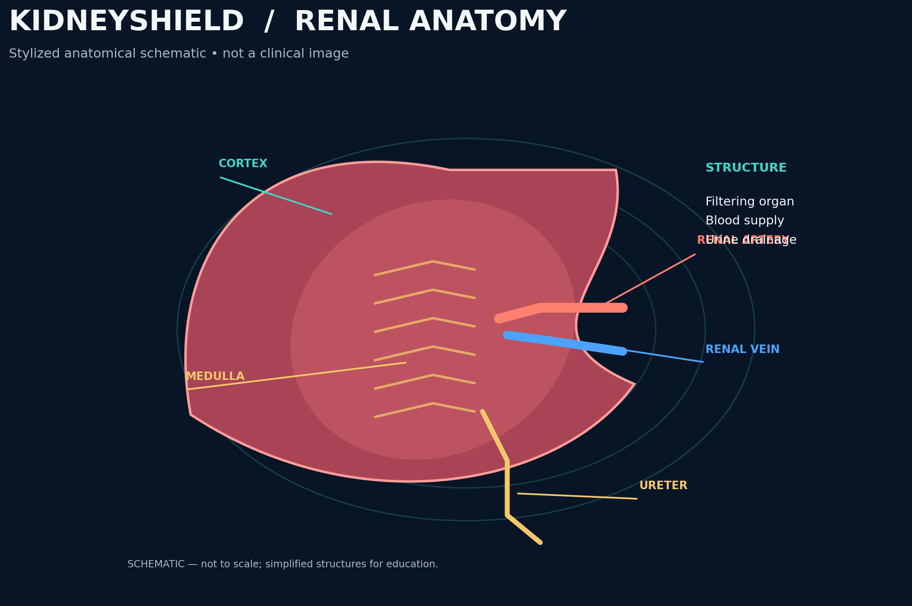
  <figcaption><strong>Figure 1.</strong> Kidney anatomy provides the biological starting point for investigating diseases that affect renal function.</figcaption>
</figure>

Official patient and scientific resources:

* [National Institute of Diabetes and Digestive and Kidney Diseases: Chronic Kidney Disease](https://www.niddk.nih.gov/health-information/kidney-disease/chronic-kidney-disease-ckd)
* [National Institute of Diabetes and Digestive and Kidney Diseases: Your Kidneys and How They Work](https://www.niddk.nih.gov/health-information/kidney-disease/kidneys-how-they-work)

### Why drug repurposing?

Developing a completely new medicine can require substantial investment, years of research, and extensive evaluation of safety and effectiveness. Repurposing investigates whether an existing medicine might have a useful, scientifically supported role in a different disease or indication.

Existing medicines may have prior human safety information, known formulations, established manufacturing, and previously characterized pharmacology. Those advantages can make a new-use hypothesis worth investigating, but they **do not remove the need to establish safety and effectiveness for the proposed indication**.

KidneyShield focuses on the evidence needed to distinguish a plausible research lead from a candidate that merits further scientific evaluation.

### The central research question

Can publicly available clinical literature and trial records be systematically screened to identify generic medicines with credible signals of potential benefit in CKD, while keeping evidence strength, uncertainty, and source traceability visible?

---

## 2. Understanding the kidney: biological context

KidneyShield is not intended to infer drug efficacy from images of kidney tissue. The anatomy and microscopy resources provide scientific context for understanding renal structure and the kinds of damage discussed in kidney-disease research.

<figure>
  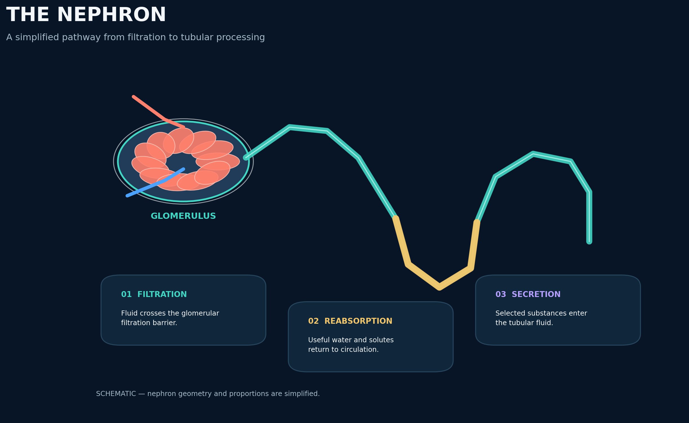
  <figcaption><strong>Figure 2.</strong> The nephron is the functional unit responsible for filtration and the processing of fluid and solutes.</figcaption>
</figure>

<figure>
  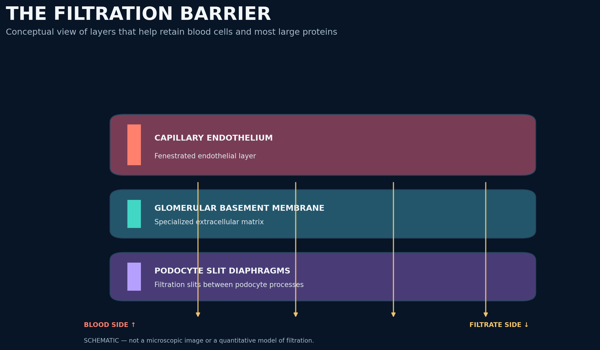
  <figcaption><strong>Figure 3.</strong> The glomerular filtration barrier is important to understanding protein leakage and several forms of kidney injury.</figcaption>
</figure>

The glomerulus filters blood, while the renal tubules reabsorb needed substances and help regulate fluid and electrolyte balance. Different kidney diseases can affect different structures, so a drug's proposed mechanism and evidence must be interpreted in the context of the condition being studied.

For example, evidence from diabetic kidney disease should not automatically be generalized to every cause of CKD. Similarly, a biomarker change or a short-term improvement in a laboratory measure is not necessarily proof that a treatment prevents kidney failure.

---

## 3. The project journey

KidneyShield developed from a broad question about whether existing generic medicines could help address CKD progression into a more structured evidence-screening and review workflow.

### Stage 1 — Define the research problem

The initial question was deliberately broad: which existing medicines have been investigated in relation to kidney disease, renal outcomes, or CKD progression?

A broad starting point is useful for discovery, but it can also produce irrelevant records, repeated publications, incidental drug mentions, and studies that do not evaluate a meaningful clinical outcome.

### Stage 2 — Build a structured evidence workflow

The research workflow was organized into stages that separate literature discovery from interpretation:

1. Collect relevant literature and clinical-study records.
2. Screen records for kidney-disease relevance and outcome terminology.
3. Extract drug names, study characteristics, and outcome-related information where available.
4. Classify records by study design and evidence-review priority.
5. Build structured tables that preserve record-level information and source links.
6. Identify candidate records for manual verification.
7. Review promising findings against primary publications and trial records.
8. Generate visual summaries to communicate the state of the evidence and the remaining gaps.

### Stage 3 — Make the evidence auditable

Instead of relying on an unstructured list of promising medicines, KidneyShield generates linked evidence tables and review queues. These make it easier to examine which records were found, which need verification, how studies are classified, and where additional research is required.

### Stage 4 — Connect analysis to a real clinical question

Pentoxifylline and the PREDIAN trial provide a concrete example of why the project needs both computational screening and careful human review. A published clinical trial offers a stronger starting point than an isolated mention of a drug, but its population, endpoints, limitations, and reproducibility still need to be assessed.

### Stage 5 — Work toward a research-ready evidence package

The longer-term aim is to move from a broad screening landscape to a carefully documented candidate-specific assessment. That requires verified primary sources, appropriate statistical interpretation, safety information, an understanding of current treatment options, and explicit documentation of evidence gaps.

---

## 4. Technical stack

KidneyShield uses a notebook-centered research approach.

| Technology or artifact                     | Role in the project                                                                   |
| ------------------------------------------ | ------------------------------------------------------------------------------------- |
| **Python**                                 | Data processing, screening logic, evidence organization, and analysis                 |
| **Jupyter notebooks**                      | A cell-based environment for documenting and running research steps                   |
| **Kaggle-compatible workflows**            | Research execution and notebook-based experimentation                                 |
| **CSV**                                    | Portable tables for evidence records, review queues, summaries, and source tracking   |
| **Scientific visualization**               | Charts and visual summaries that make patterns and evidence gaps easier to inspect    |
| **GitHub**                                 | Versioned source code, research artifacts, figures, tables, and project documentation |
| **Primary publications and trial records** | Sources for verifying candidate findings                                              |

The repository contains two principal research notebooks:

* [`kidneyshield-ai-driven-generic-drug-repurposing-f.ipynb`](https://github.com/ut1776/kidneyshield/blob/main/kidneyshield-ai-driven-generic-drug-repurposing-f.ipynb)
* [`kidneyshield-research-phase-2.ipynb`](https://github.com/ut1776/kidneyshield/blob/main/kidneyshield-research-phase-2.ipynb)

The notebooks document the computational research workflow. Their outputs should be interpreted according to the actual data sources, code, and verification performed—not as independently validated clinical findings.

### What reproducibility means here

A reproducible research workflow should make it possible to inspect:

* What sources were considered.
* What information was extracted.
* What screening or prioritization rules were applied.
* What data were saved to each output table.
* Which records still require manual review.
* Which sources support a reported finding.
* What assumptions and limitations remain.

Reproducibility does not automatically mean that every source is complete, every extracted value is correct, or every candidate has been clinically validated.

---

## 5. Research pipeline

The workflow is designed to move from broad discovery toward focused review.

| Stage                       | Purpose                                                         | Example output                                   |
| --------------------------- | --------------------------------------------------------------- | ------------------------------------------------ |
| 1. Source discovery         | Find potentially relevant publications and study records        | Source index and screening queues                |
| 2. Relevance screening      | Identify kidney-disease and outcome-related records             | Kidney-relevance and outcome-term summaries      |
| 3. Evidence extraction      | Organize drug names, outcomes, and study information            | Evidence matrix and candidate records            |
| 4. Study classification     | Group records by study design and available evidence            | Study-design summaries                           |
| 5. Candidate prioritization | Identify records that warrant more detailed review              | Priority queues and review shortlists            |
| 6. Source verification      | Check candidate claims against primary sources                  | Verification and crosswalk tables                |
| 7. Quantitative summaries   | Describe the available evidence landscape                       | Counts, distributions, and statistical summaries |
| 8. Scientific visualization | Communicate findings and uncertainty                            | Figures and research dashboards                  |
| 9. Candidate assessment     | Evaluate the complete evidence for a specific drug–disease pair | Candidate-specific evidence package              |

**Important distinction:** a mention count is not a measure of treatment effectiveness. A high-priority record is a review target, not a declaration that a drug works. Automated extraction and screening require validation against source documents.

---

## 6. Scientific figures and visual gallery

The `figures/` directory contains anatomy illustrations, microscopy-related images, literature-screening summaries, study-design analyses, and other visual outputs.

The figures below are embedded from the repository so readers can inspect them directly on GitHub.

### A. Research overview and evidence dashboard

<figure>
  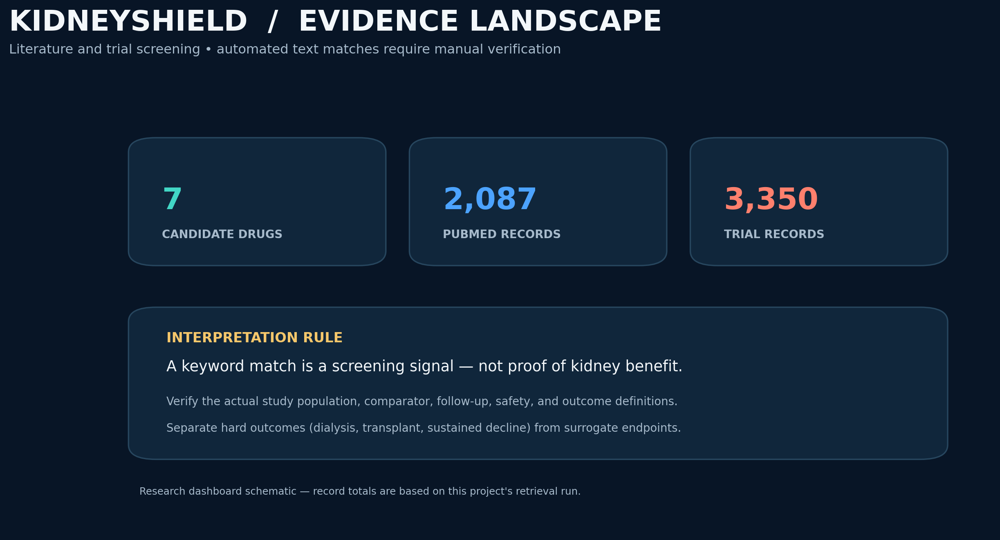
  <figcaption><strong>Figure 4.</strong> An overview of evidence-screening outputs and the research landscape.</figcaption>
</figure>

<figure>
  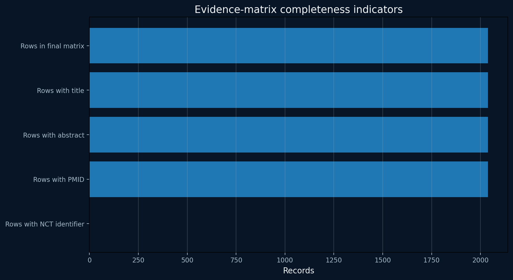
  <figcaption><strong>Figure 5.</strong> A workflow-oriented view of evidence processing and review status.</figcaption>
</figure>

### B. Literature discovery and outcome screening

<figure>
  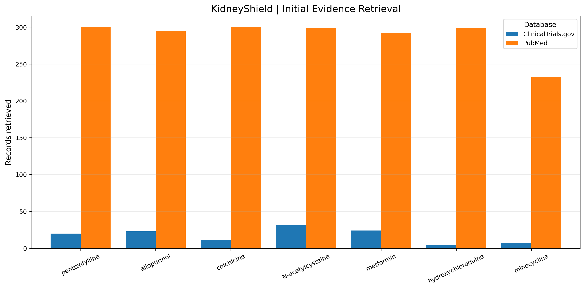
  <figcaption><strong>Figure 6.</strong> Literature retrieval volume helps describe the size of the discovery stage; it does not measure clinical efficacy.</figcaption>
</figure>

<figure>
  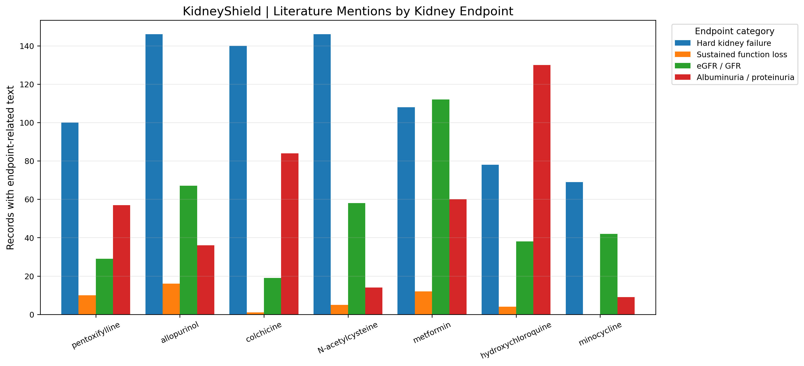
  <figcaption><strong>Figure 7.</strong> Endpoint-oriented screening can help identify which clinical outcomes appear in the collected evidence.</figcaption>
</figure>

<figure>
  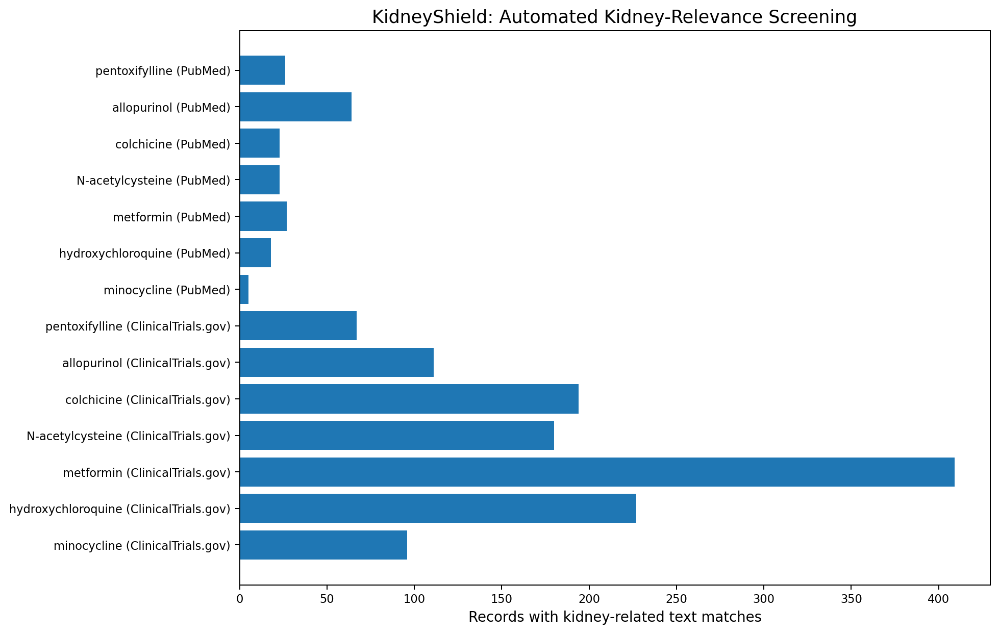
  <figcaption><strong>Figure 8.</strong> A summary of kidney-relevance screening.</figcaption>
</figure>

<figure>
  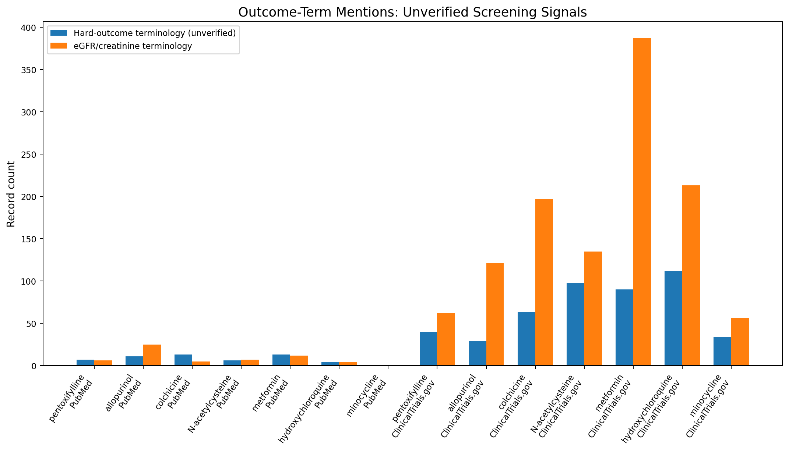
  <figcaption><strong>Figure 9.</strong> Outcome-term counts are useful for organizing records, but the underlying publications must be checked to establish what was actually measured.</figcaption>
</figure>

### C. Study-design and candidate-prioritization summaries

<figure>
  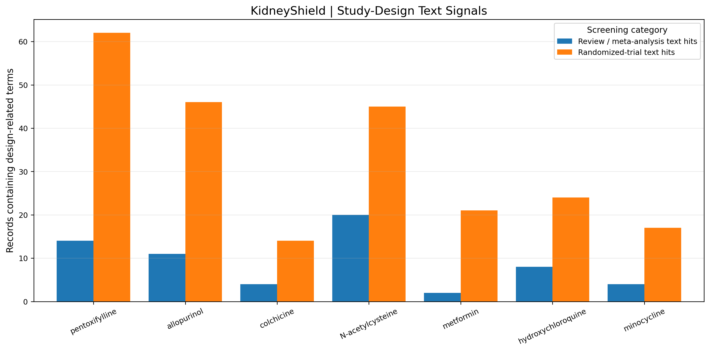
  <figcaption><strong>Figure 10.</strong> Study-design classification helps guide the next stage of evidence review.</figcaption>
</figure>

<figure>
  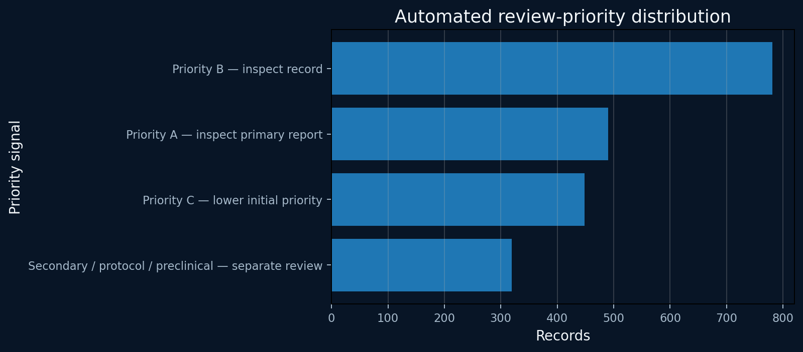
  <figcaption><strong>Figure 11.</strong> Review-priority distributions help manage the manual verification workload.</figcaption>
</figure>

<figure>
  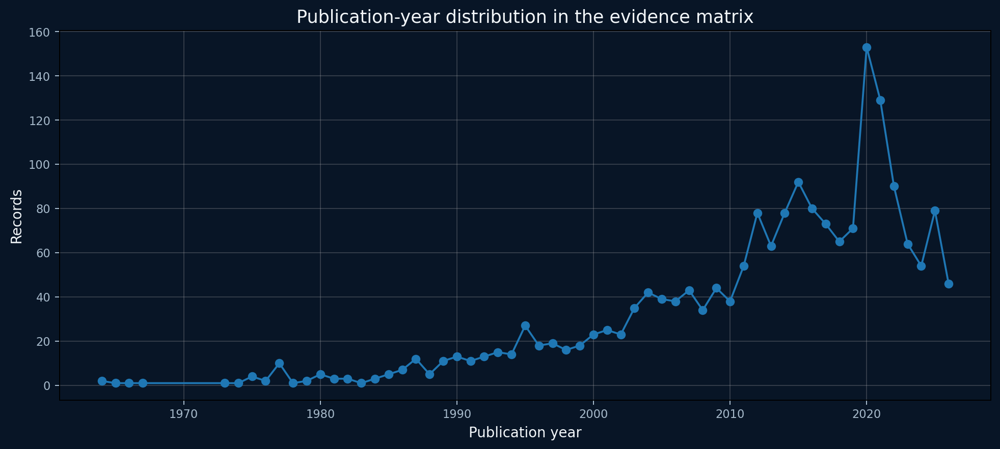
  <figcaption><strong>Figure 12.</strong> Publication-year distributions provide context for the age and coverage of the literature collection.</figcaption>
</figure>

<figure>
  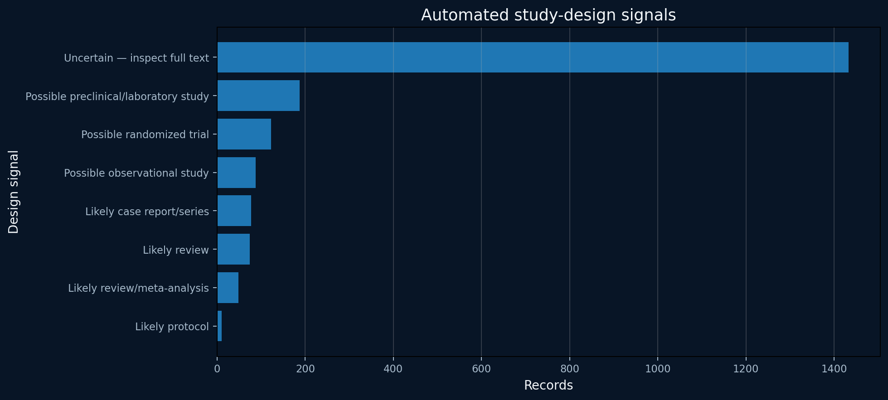
  <figcaption><strong>Figure 13.</strong> A second study-design summary from the project's visual outputs.</figcaption>
</figure>

### D. Kidney histology and microscopy resources

Kidney tissue images can help readers understand the biological structures described in nephrology research. These visual resources are educational and contextual; they are not a validated diagnostic model and are not being presented as proof that a candidate drug improves kidney tissue.

<figure>
  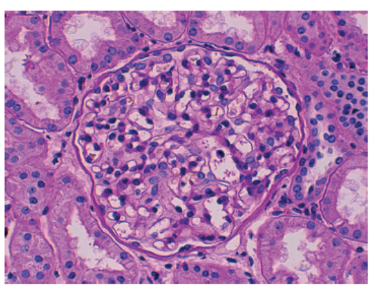
  <figcaption><strong>Figure 14.</strong> Reference visualization of normal glomerular architecture.</figcaption>
</figure>

<figure>
  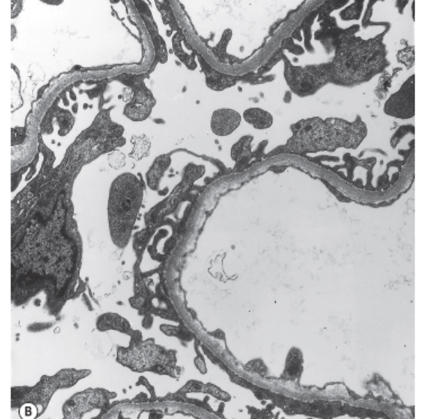
  <figcaption><strong>Figure 15.</strong> Reference view of the glomerular capillary wall.</figcaption>
</figure>

<figure>
  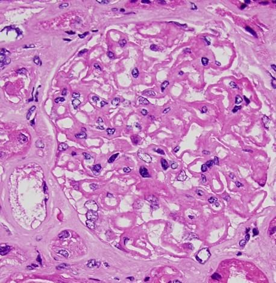
  <figcaption><strong>Figure 16.</strong> Kidney biopsy reference associated with membranous nephropathy.</figcaption>
</figure>

<figure>
  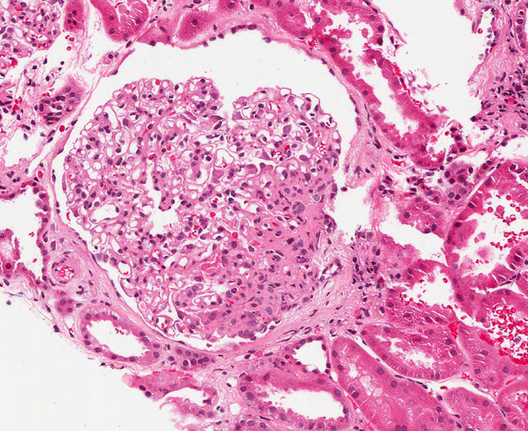
  <figcaption><strong>Figure 17.</strong> Biopsy reference associated with focal segmental glomerulosclerosis.</figcaption>
</figure>

For the full collection, including additional microscopy images, contact sheets, and quality-control visualizations, visit the **[figures directory](https://github.com/ut1776/kidneyshield/tree/main/figures)**.

**Image provenance:** the source, license, diagnostic context, and permitted reuse of each third-party image should be checked before redistribution. A filename or visual resemblance alone is not sufficient to establish provenance.

---

## 7. Evidence tables and downloadable research data

KidneyShield stores research outputs in CSV format so that they can be inspected in spreadsheet software, analyzed with Python, and compared with the underlying publications.

Visit the complete **[tables directory](https://github.com/ut1776/kidneyshield/tree/main/tables)** to browse the available files.

### Core evidence and verification tables

| Table                                                                                                                | Intended use                                                         |
| -------------------------------------------------------------------------------------------------------------------- | -------------------------------------------------------------------- |
| [`Source_Index.csv`](https://github.com/ut1776/kidneyshield/blob/main/tables/Source_Index.csv)                       | Index of collected sources and their identifiers                     |
| [`Evidence_Matrix.csv`](https://github.com/ut1776/kidneyshield/blob/main/tables/Evidence_Matrix.csv)                 | Structured view of evidence records and candidate relationships      |
| [`PubMed_Trial_Crosswalk.csv`](https://github.com/ut1776/kidneyshield/blob/main/tables/PubMed_Trial_Crosswalk.csv)   | Cross-referencing publication records and clinical-trial information |
| [`Verify_Studies.csv`](https://github.com/ut1776/kidneyshield/blob/main/tables/Verify_Studies.csv)                   | Records requiring or supporting primary-source verification          |
| [`Manual_Review_Shortlist.csv`](https://github.com/ut1776/kidneyshield/blob/main/tables/Manual_Review_Shortlist.csv) | Shortlist for closer human review                                    |
| [`Priority_A_Queue.csv`](https://github.com/ut1776/kidneyshield/blob/main/tables/Priority_A_Queue.csv)               | Records assigned high review priority                                |
| [`Priority_A_Records.csv`](https://github.com/ut1776/kidneyshield/blob/main/tables/Priority_A_Records.csv)           | Detailed records in the high-priority group                          |
| [`Review_Priorities.csv`](https://github.com/ut1776/kidneyshield/blob/main/tables/Review_Priorities.csv)             | Review-priority information                                          |
| [`Design_Summary.csv`](https://github.com/ut1776/kidneyshield/blob/main/tables/Design_Summary.csv)                   | Summary of study-design classifications                              |
| [`Design_Signals.csv`](https://github.com/ut1776/kidneyshield/blob/main/tables/Design_Signals.csv)                   | Study-design signal summaries                                        |
| [`Drug_Counts.csv`](https://github.com/ut1776/kidneyshield/blob/main/tables/Drug_Counts.csv)                         | Drug-record count summaries                                          |
| [`Priority_Summary_Cell18.csv`](https://github.com/ut1776/kidneyshield/blob/main/tables/Priority_Summary_Cell18.csv) | Review-priority summary generated during notebook analysis           |

### Additional screening and analysis outputs

The repository also includes additional CSV outputs from the notebook workflow. Their names indicate the analysis stage that generated them.

| Output group                     | Files                                                                                                                |
| -------------------------------- | -------------------------------------------------------------------------------------------------------------------- |
| General screening                | `cell17_all_screened_records.csv`, `cell17_pubmed_screening_queue.csv`, `cell17_clinical_trials_screening_queue.csv` |
| Outcome and co-mention summaries | `cell17_drug_outcome_co_mentions.csv`, `cell17_outcome_signal_summary.csv`                                           |
| Priority and design summaries    | `cell17_screening_priority_summary.csv`, `cell17_study_design_summary.csv`                                           |
| Conservative review summaries    | `cell18_conservative_design_summary.csv`, `cell18_review_priority_summary.csv`                                       |
| Numerical candidate extraction   | `cell18_numerical_candidate_extraction.csv`                                                                          |
| Primary-study review             | `cell18_primary_study_review_queue.csv`, `cell18_priority_A_records.csv`                                             |
| Candidate record counts          | `cell19_candidate_drug_record_counts.csv`                                                                            |
| Design signal summary            | `cell19_design_signal_summary.csv`                                                                                   |
| Unverified evidence matrix       | `cell19_full_evidence_matrix_unverified.csv`                                                                         |
| Manual verification              | `cell19_manual_verification_shortlist.csv`                                                                           |
| Master review queue              | `cell19_priority_A_master_queue.csv`                                                                                 |

Browse or download these outputs from the **[tables directory](https://github.com/ut1776/kidneyshield/tree/main/tables)**.

**Interpretation note:** files labeled `unverified`, `queue`, `shortlist`, or `priority` should be treated according to those labels. Inclusion in a table is not equivalent to verification, peer review, a positive trial result, or proof of clinical benefit.

---

## 8. Case study: pentoxifylline and CKD progression

One of the motivating examples for KidneyShield is pentoxifylline, an existing medicine investigated in research involving diabetic kidney disease.

The PREDIAN study provides a useful illustration of the difference between a published clinical signal and a treatment recommendation.

### What did the PREDIAN study investigate?

The published study evaluated pentoxifylline in patients with type 2 diabetes and stage 3–4 CKD who were receiving renin–angiotensin system inhibition.

The report included 169 participants: 82 in the pentoxifylline group and 87 in the control group, with follow-up over two years.

The publication reported the following mean eGFR decline:

| Reported measure       | Pentoxifylline group |  Control group |
| ---------------------- | -------------------: | -------------: |
| Participants           |                   82 |             87 |
| Mean eGFR decline      |            2.1 ± 0.4 |      6.5 ± 0.4 |
| Units for eGFR decline |       mL/min/1.73 m² | mL/min/1.73 m² |

The article reported a between-group difference of approximately 4.3 mL/min/1.73 m², with a 95% confidence interval of 3.1–5.5 and p < 0.001.

**Primary sources:**

* [PREDIAN study — PubMed](https://pubmed.ncbi.nlm.nih.gov/24970885/)
* [Full-text publication — PubMed Central](https://pmc.ncbi.nlm.nih.gov/articles/PMC4279740/)

### Why this matters to KidneyShield

This example shows why a drug-repurposing workflow needs to retain study design, population, treatment context, endpoints, numerical findings, and source links together. A numerical result without the study's context can easily be misinterpreted.

It also illustrates why the workflow cannot stop at identifying a positive result. A rigorous assessment must examine potential bias, precision, the population studied, consistency with other research, adverse effects, interactions, and the relevance of the endpoint to patients.

### What this study does not establish

* It does not establish that pentoxifylline is a standard treatment for CKD progression.
* It does not prove that the same result applies to every CKD cause or patient population.
* It does not, by itself, establish that pentoxifylline prevents kidney failure, dialysis, transplantation, or death.
* It does not replace an assessment of the full clinical literature, current prescribing information, and contemporary treatment guidelines.

The findings above are a summary of a published study, not a new clinical trial conducted by KidneyShield.

---

## 9. Quantitative analysis: what the numbers can and cannot tell us

Quantitative analysis helps describe the collected evidence and organize subsequent review. Examples of useful summaries include:

* The number of retrieved and screened records.
* The distribution of records across study-design categories.
* The frequency of drug and outcome mentions.
* The distribution of publication years.
* The number of records assigned to different review-priority groups.
* The proportion of candidate records requiring manual verification.
* The availability of numerical clinical outcomes in candidate studies.

These measures can help identify gaps, organize research effort, and reveal where additional primary-source review is needed.

They should not be confused with clinical efficacy estimates.

For example, a medicine mentioned in many publications may be widely studied, frequently discussed, or repeatedly included in reviews without having strong evidence of benefit for CKD. Similarly, a high number of outcome-term mentions does not show that patients experienced improved outcomes.

A defensible candidate assessment ultimately requires study-level interpretation, source verification, appropriate statistical analysis, and consideration of the total evidence.

---

## 10. Alignment with the NIH ReGen Drugs Evidence Package Challenge

KidneyShield is independently developed and is relevant to the research goals of the NIH's **Repurposing Generic (ReGen) Drugs Evidence Package Challenge**.

**Official challenge page:** [NIH — Repurposing Generic (ReGen) Drugs Evidence Package Challenge](https://www.nih.gov/challenges/repurposing-generic-regen-drugs-evidence-package-challenge)

The challenge is led by the National Center for Advancing Translational Sciences (NCATS) at NIH, with support from the NIH Chief Artificial Intelligence Officer within the NIH Office of the Director. Chronic kidney disease is one of the challenge's listed priority conditions.

### Official challenge details

| Item                                        | Official information                                         |
| ------------------------------------------- | ------------------------------------------------------------ |
| Challenge                                   | Repurposing Generic (ReGen) Drugs Evidence Package Challenge |
| Lead organization                           | National Institutes of Health (NIH), through NCATS           |
| Priority condition relevant to this project | Chronic kidney disease                                       |
| Challenge launch                            | September 8, 2026                                            |
| Registration opens                          | November 2, 2026                                             |
| Registration deadline                       | January 15, 2027                                             |
| Evidence package submission deadline        | March 26, 2027                                               |
| Review completed                            | June 3, 2027                                                 |
| Winners announced                           | July 2, 2027                                                 |
| Total potential prize purse                 | Up to $4 million                                             |
| Potential awards                            | Up to 40 awards of $100,000 each                             |

Dates and rules should be rechecked on the [official NIH challenge page](https://www.nih.gov/challenges/repurposing-generic-regen-drugs-evidence-package-challenge) before registration or submission.

### What the challenge is looking for

The challenge seeks evidence-based opportunities to repurpose generic medicines for costly conditions. A competitive drug–disease proposal needs a credible clinical signal of efficacy beyond an individual case report or the experience of a single institution.

The official criteria emphasize several dimensions:

1. Scientific rationale and risk–benefit considerations.
2. Relevant non-clinical evidence.
3. Safety.
4. Clinical and real-world evidence.
5. Pharmacogenomic considerations, where applicable.
6. A defensible treatment regimen.
7. Additional considerations, including evidence gaps and the need for further studies.

The proposed medicine must also meet the challenge's requirements concerning generic status, patents, and exclusivity. The official rules—not this repository—determine eligibility.

### How KidneyShield relates to these goals

| Challenge need                            | KidneyShield contribution                                                       |
| ----------------------------------------- | ------------------------------------------------------------------------------- |
| Find candidate drug–disease relationships | Structured literature and trial-record screening                                |
| Organize clinical evidence                | Evidence matrices and record-level CSV outputs                                  |
| Assess study types                        | Study-design summaries and classification outputs                               |
| Prioritize candidate records              | Review-priority tables and manual-review queues                                 |
| Trace claims to sources                   | Source indexes and publication/trial crosswalks                                 |
| Evaluate numerical results                | Extraction and quantitative-summary workflows, followed by verification         |
| Communicate evidence clearly              | Figures, dashboards, and structured tables                                      |
| Prepare for deeper review                 | Candidate-specific primary-source verification and documentation of uncertainty |

These are areas of methodological relevance, not a claim that KidneyShield satisfies every challenge requirement or that a submission has been accepted.

### A critical next step: candidate qualification

A candidate must be evaluated against the actual challenge rules before it can be considered a viable submission. That includes checking:

* Whether the medicine meets the requirements for generic status and absence of disqualifying patent or exclusivity protection.
* Whether the proposed indication fits the challenge's priority and evidence criteria.
* Whether the clinical signal meets the minimum evidence standard.
* Whether safety, contraindications, interactions, dosing, and formulation are sufficiently documented.
* Whether the evidence is reproducible and supported by primary sources.
* Whether the submission meets the official format, page limits, registration requirements, and eligibility rules.

Pentoxifylline and the PREDIAN study are an example for evidence review—not an automatic declaration that pentoxifylline is the strongest candidate or eligible for a prize.

**No NIH sponsorship or endorsement is implied.** KidneyShield is an independent project, and its appearance alongside the ReGen Challenge does not mean it is affiliated with, funded by, approved by, or endorsed by NIH or NCATS.

---

## 11. What is novel about the approach?

The project emphasizes the research process rather than presenting a black-box list of medicines.

Its methodological priorities are:

* **Traceability:** preserve links between candidate records and their sources.
* **Separation of discovery and verification:** use automated screening to organize research, then inspect the underlying evidence.
* **Evidence-aware prioritization:** distinguish records that deserve attention from findings that have been confirmed.
* **Structured outputs:** make research artifacts accessible as ordinary CSV files.
* **Visual communication:** show the evidence landscape and review workload in ways that are easier to inspect.
* **Explicit uncertainty:** document the limitations of literature extraction and the need for clinical interpretation.

These principles are intended to make a drug-repurposing research workflow easier to audit and improve. They do not establish that the workflow has already demonstrated superior accuracy or clinical utility; such claims would require formal validation.

---

## 12. Limitations and responsible interpretation

KidneyShield is a research prototype, and its current outputs have important limitations.

### Literature coverage

Publications and trial registries may be incomplete, inconsistently indexed, duplicated, or difficult to compare. A screening result depends on the sources searched and the retrieval methods used.

### Extraction quality

Drug names, outcomes, study populations, and numerical results may be missed or misclassified by automated or semi-automated processing. Primary-source verification is necessary before a result is used in a formal evidence package.

### Study quality

A publication's existence does not establish that its findings are reliable. Study design, risk of bias, sample size, missing data, endpoint selection, statistical uncertainty, and replication all matter.

### Clinical generalizability

Evidence from a specific CKD subgroup may not apply to other causes or stages of kidney disease. The role of background therapies and patient characteristics also needs consideration.

### Safety

A medicine's established use for one indication does not prove that its benefit–risk balance is acceptable for a different indication or patient population.

### Validation

A reproducible notebook is not the same as a validated clinical tool. The current project should not be used to make individual treatment decisions, alter prescriptions, or replace clinical judgment.

---

## 13. Roadmap

The project can develop further through a series of evidence-quality milestones.

* [ ] Verify prioritized records against primary publications and trial registries.
* [ ] Resolve duplicate records and document source provenance.
* [ ] Validate extracted numerical outcomes against the original articles.
* [ ] Distinguish exploratory associations from evidence of treatment effects.
* [ ] Assess risk of bias, safety, and consistency across relevant studies.
* [ ] Evaluate candidate generic status, patent/exclusivity criteria, and challenge fit.
* [ ] Prepare candidate-specific evidence tables with complete citations.
* [ ] Document reproducible analysis steps and the tools and parameters used.
* [ ] Identify unresolved questions and studies needed to strengthen the evidence.
* [ ] Assess the resulting evidence package against the current official NIH challenge rules.

The aim is not to force a positive conclusion. If a candidate's evidence is weak, inconsistent, or insufficient, the workflow should make that clear.

---

## 14. How to explore the repository

No special software is required to read the README, figures, or CSV files in GitHub.

To inspect the project:

1. Open the [main repository](https://github.com/ut1776/kidneyshield).
2. Open the notebook files to review the computational workflow.
3. Open `figures/` to explore scientific visualizations.
4. Open `tables/` to inspect the structured research outputs.
5. Open `Research Report/` to locate the available written research materials.
6. Follow source links in the evidence tables to review the original publications or trial records.

For analysis, Python and a notebook environment such as Kaggle or Jupyter can be used to inspect and reproduce the workflow, subject to the notebooks' actual dependencies, data availability, and execution requirements.

---

## 15. Sponsorship, independence, and acknowledgments

KidneyShield is an independent research project. No formal project sponsor is represented here.

The NIH/NCATS ReGen Drugs Evidence Package Challenge is referenced because of its stated interest in evidence-based generic-drug repurposing for high-cost conditions, including CKD. Mention of that challenge is for context and does not indicate a formal partnership.

Institutional names, publications, clinical trials, public datasets, and educational resources should be credited to their original sources. The project should not be represented as an NIH-, NCATS-, NIDDK-, FDA-, or other government-endorsed product.

---

## 16. License and reuse

Consult the repository's [LICENSE](https://github.com/ut1776/kidneyshield/blob/main/LICENSE) for the applicable terms governing project code and materials. Third-party publications, images, datasets, and other external resources may have separate licensing or reuse restrictions.

---

## Final perspective

KidneyShield begins with a practical question: **How can researchers move from a large body of kidney-disease literature to a smaller, more transparent, and more defensible set of generic-drug repurposing hypotheses?**

Its approach is to organize the search, preserve source traceability, prioritize review, inspect numerical findings, and make the research process visible through tables and figures.

The next measure of success is not the number of records screened or charts generated. It is whether the resulting evidence can withstand careful review—whether a candidate is supported, contradicted, or ultimately ruled out.

*KidneyShield is a research and evidence-screening project, not medical advice. No medicine should be started, stopped, or changed on the basis of this repository.*
