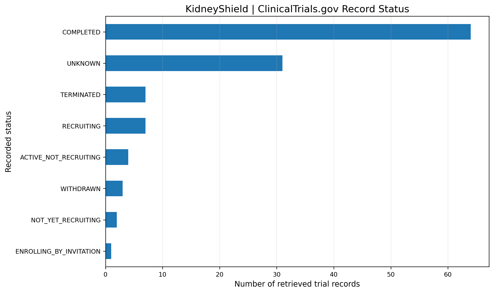
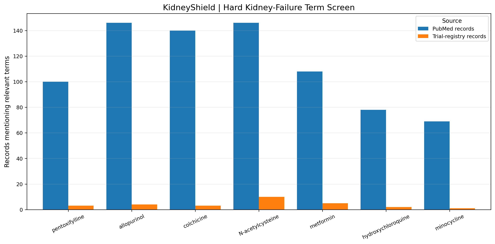
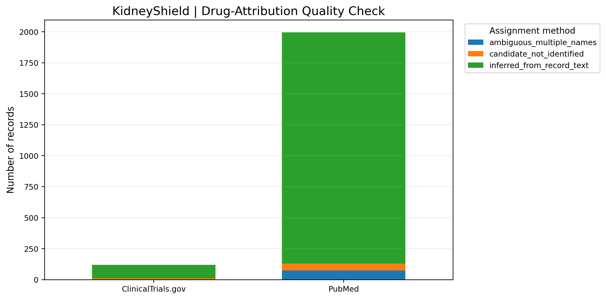

# KidneyShield

### An open, evidence-driven research project exploring whether existing medicines could help slow chronic kidney disease progression

  <strong>Drug Repurposing · Clinical Evidence · Reproducible Research · Kidney Health</strong>

  <a href="https://github.com/ut1776/kidneyshield">Repository</a> ·
  <a href="https://github.com/ut1776/kidneyshield/tree/main/figures">Figures</a> ·
  <a href="https://github.com/ut1776/kidneyshield/tree/main/tables">Evidence Tables</a> ·
  <a href="https://github.com/ut1776/kidneyshield/tree/main/Research%20Report">Research Report</a> ·
  <a href="https://github.com/ut1776/kidneyshield/tree/main/ZipFiles">Research Archives</a>

---

## The idea in one minute

**What if a medicine that already exists could offer an additional way to protect kidney function?**

KidneyShield is an independent research project investigating that question. It uses a structured, reproducible approach to screen scientific literature and clinical-trial records, organize possible drug–kidney outcome signals, prioritize promising records for review, and distinguish preliminary findings from evidence that has been verified in original studies.

One important candidate being examined is **pentoxifylline**, an established medicine that has been investigated for possible effects on kidney disease progression, particularly in people with diabetic kidney disease.

KidneyShield does not assume that pentoxifylline works. It asks a more careful set of questions:

* What have researchers actually reported?
* Were the studies randomized trials, observational studies, reviews, or other designs?
* Which kidney outcomes were measured?
* How strong and consistent are the findings?
* Can the original paper or trial record be located and checked?
* What evidence is still missing before a treatment hypothesis could be considered clinically credible?

The goal is not to promote a drug. It is to make the evidence easier to find, inspect, compare, and challenge.

## Why this research matters

### The problem: chronic kidney disease

Your kidneys act as the body's filtration system. They help remove waste and excess fluid from the blood, balance important minerals, and support other essential functions.

**Chronic kidney disease (CKD)** means that kidney structure or function has been abnormal over time. CKD can progress slowly, and early disease may produce few noticeable symptoms. Diabetes and high blood pressure are two major causes.

The U.S. National Institute of Diabetes and Digestive and Kidney Diseases estimates that more than 35 million U.S. adults have CKD—more than one in seven adults. Many people are unaware they have it.

Sources: [NIDDK — Kidney Disease Statistics](https://www.niddk.nih.gov/health-information/health-statistics/kidney-disease) · [NIDDK — What Is Chronic Kidney Disease?](https://www.niddk.nih.gov/health-information/kidney-disease/chronic-kidney-disease-ckd/what-is-chronic-kidney-disease)

### Why progression matters

CKD is not simply a problem of having an abnormal laboratory result. For some people, kidney function gradually declines over years. Advanced disease can require dialysis or a kidney transplant and can contribute to substantial health, financial, and quality-of-life burdens.

Clinicians already have established ways to manage CKD risk, including treating its underlying causes and using evidence-based kidney-protective therapies when appropriate. However, not every patient responds the same way, and residual risk remains.

KidneyShield explores whether existing medicines might offer additional treatment hypotheses worth rigorous investigation. It is intended to complement—not replace—established care.

## What is drug repurposing?

Drug repurposing means investigating whether a medicine developed or approved for one purpose might also be useful for a different condition.

| Traditional drug development                               | Drug repurposing                                                           |
| ---------------------------------------------------------- | -------------------------------------------------------------------------- |
| Often begins with a new compound or target                 | Begins with a medicine that already exists                                 |
| May require extensive early discovery work                 | Can build on existing knowledge about the medicine                         |
| Safety, dosing, and effectiveness still require evaluation | Existing safety knowledge can help, but the new use still needs evaluation |
| May take many years and substantial resources              | May provide a more efficient starting point for research                   |

Repurposing is not a shortcut around clinical evidence. A drug's existing approval for one condition does not establish that it is effective, safe at the same dose, or appropriate for a different condition.

KidneyShield treats repurposing as a **research prioritization problem**: identify plausible candidates, examine the quality of the evidence, and determine what should be verified next.

## Why investigate pentoxifylline?

Pentoxifylline is an established medicine used for a vascular indication. Researchers have also investigated its possible effects on inflammation-related pathways and kidney outcomes.

In diabetic kidney disease, researchers have studied whether pentoxifylline might help reduce urinary albumin loss or slow the decline in kidney filtration. These are research questions—not proof that the medicine prevents kidney failure.

### The PREDIAN trial: an important starting point

The PREDIAN trial is a key clinical study in this research area.

**What was studied?**

| Trial feature        | Plain-English explanation                                             |
| -------------------- | --------------------------------------------------------------------- |
| Population           | 169 people with type 2 diabetes and stage 3–4 chronic kidney disease  |
| Study design         | Prospective, randomized, open-label clinical trial                    |
| Groups               | 82 participants received pentoxifylline; 87 were in the control group |
| Treatment period     | Two years                                                             |
| Background treatment | Both groups received renin–angiotensin system (RAS) inhibitors        |
| Main kidney measure  | Change in estimated glomerular filtration rate (eGFR)                 |
| Additional measure   | Urinary albumin excretion                                             |

**What did the researchers report?**

The study reported a smaller average decline in eGFR in the pentoxifylline group than in the control group over two years.

| Reported result                                     | Pentoxifylline group |          Control group |
| --------------------------------------------------- | -------------------: | ---------------------: |
| Mean eGFR decline over the study                    |            2.1 ± 0.4 |              6.5 ± 0.4 |
| Between-group difference in decline                 |                    - |     4.3 mL/min/1.73 m² |
| Reported 95% confidence interval for the difference |                    - | 3.1–5.5 mL/min/1.73 m² |
| Statistical comparison                              |                    - |              p < 0.001 |

*The eGFR values are reported as mean ± standard error, in mL/min/1.73 m². The between-group difference and confidence interval are taken from the published trial abstract.*

The researchers also reported a more favorable change in urinary albumin excretion in the pentoxifylline group.

**What does that mean in everyday language?**

* **eGFR** is an estimate of how effectively the kidneys filter blood. A declining eGFR can indicate worsening kidney function.
* **Urinary albumin** is a blood protein that can leak into the urine when kidney filtering structures are damaged. Persistent albumin in the urine can be a sign of kidney disease.
* **p < 0.001** indicates that the observed between-group difference would be unlikely under the statistical model if there were truly no difference. It does not tell us whether the result will be reproduced or prove that the drug prevents kidney failure.
* **A confidence interval** describes the statistical uncertainty around an estimated effect; it is not a guarantee of an individual's treatment outcome.

Primary source: [PREDIAN trial — PubMed](https://pubmed.ncbi.nlm.nih.gov/24970885/) · [Full article — PubMed Central](https://pmc.ncbi.nlm.nih.gov/articles/PMC4279740/)

### Why PREDIAN is not the end of the story

A positive trial is a reason to investigate further—not a reason to skip further investigation.

The PREDIAN findings must be interpreted in the context of the study's population, duration, design, endpoints, and limitations.

| Question                                         | Why it matters                                                                                                                 |
| ------------------------------------------------ | ------------------------------------------------------------------------------------------------------------------------------ |
| Does the finding reproduce in other populations? | Results from people with type 2 diabetes and stage 3–4 CKD may not generalize to every person with CKD.                        |
| Are the findings consistent across studies?      | One study can produce an effect that is smaller, absent, or different in other settings.                                       |
| Were hard clinical outcomes measured?            | A change in eGFR or albuminuria is not the same as proving fewer cases of kidney failure, dialysis, transplantation, or death. |
| What are the treatment risks?                    | Existing medicines can have adverse effects and interactions, and risk can change with kidney function.                        |
| Is the evidence sufficiently reliable?           | Study design, sample size, follow-up, missing data, and bias all affect confidence in a result.                                |

KidneyShield therefore separates a **promising signal** from a **verified clinical conclusion**.

## What KidneyShield does

KidneyShield is a research workflow—not a diagnostic tool, prescription service, or validated clinical decision-support system.

The project organizes evidence through a series of steps:

1. **Find candidate records.** Search and collect relevant clinical literature and trial-registry records.
2. **Extract evidence signals.** Identify drug names, study characteristics, outcomes, and reported results.
3. **Organize and prioritize.** Use structured tables and screening queues to help identify records that deserve closer attention.
4. **Trace each signal to its source.** Preserve links and identifiers so a reviewer can locate the underlying paper or registry entry.
5. **Verify primary studies.** Check whether the original source supports the extracted claim and whether the study design and outcome have been represented accurately.
6. **Document uncertainty.** Keep unverified records visibly separate from conclusions supported by checked evidence.

The process is designed to make it easier for another researcher to inspect the evidence and disagree with a conclusion for a specific, traceable reason.

## The research figures

The figures below summarize different aspects of the evidence-screening workflow. Each figure should be interpreted together with its underlying data table and methods.

### 1. Retrieval volume

Shows the scale of records collected or screened during the research workflow. Retrieval volume describes the search process; it is not, by itself, a measure of clinical evidence quality.

### 2. Endpoint evidence map

Organizes evidence by kidney-related endpoints. This helps distinguish studies reporting laboratory or surrogate measures from those reporting clinical outcomes.

### 3. Study-design signals

Summarizes the study-design information identified in the evidence set. Randomized trials, observational studies, reviews, and registry records answer different questions and should not be treated as interchangeable.

### 4. Trial status

Provides a view of trial-status information captured by the workflow. A trial's registry status does not establish whether its results are positive, negative, or clinically meaningful.

### 5. Hard-outcome screening

Focuses attention on whether records address outcomes such as kidney failure, dialysis, transplantation, or death. The presence of an outcome term in a record does not prove that the study demonstrated a treatment benefit.

### 6. Assignment and evidence quality

Summarizes an aspect of the workflow used to organize or assign candidate records. Automated classification or assignment is a screening aid and should not be confused with manual verification of the original study.

*If a figure does not render, open the [figures folder](https://github.com/ut1776/kidneyshield/tree/main/figures) to view the available files.*

## Explore the data tables

The repository includes CSV files designed to make the screening process inspectable without requiring a reader to navigate every notebook cell.

| File                                                                                              | What it is for                                                     |
| ------------------------------------------------------------------------------------------------- | ------------------------------------------------------------------ |
| [`Source_Index.csv`](tables/Source_Index.csv)                                                     | Index of sources collected by the workflow                         |
| [`Evidence_Matrix.csv`](tables/Evidence_Matrix.csv)                                               | Structured view of candidate evidence records                      |
| [`PubMed_Trial_Crosswalk.csv`](tables/PubMed_Trial_Crosswalk.csv)                                 | Links between literature and trial-related records where available |
| [`Verify_Studies.csv`](tables/Verify_Studies.csv)                                                 | Records flagged for source verification                            |
| [`Manual_Review_Shortlist.csv`](tables/Manual_Review_Shortlist.csv)                               | Shortlist for human review                                         |
| [`Priority_A_Queue.csv`](tables/Priority_A_Queue.csv)                                             | Prioritized queue for closer examination                           |
| [`Priority_A_Records.csv`](tables/Priority_A_Records.csv)                                         | Records associated with the Priority A review process              |
| [`Review_Priorities.csv`](tables/Review_Priorities.csv)                                           | Review-priority information                                        |
| [`Design_Summary.csv`](tables/Design_Summary.csv)                                                 | Summary of study-design information                                |
| [`Design_Signals.csv`](tables/Design_Signals.csv)                                                 | Extracted design-related signals                                   |
| [`Drug_Counts.csv`](tables/Drug_Counts.csv)                                                       | Drug counts from one screening stage                               |
| [`Drug_Counts_Cell19.csv`](tables/Drug_Counts_Cell19.csv)                                         | Drug counts associated with a later workflow stage                 |
| [`Priority_Summary_Cell18.csv`](tables/Priority_Summary_Cell18.csv)                               | Summary associated with the Cell 18 workflow                       |
| [`cell17_all_screened_records.csv`](tables/cell17_all_screened_records.csv)                       | Records captured in the Cell 17 screening stage                    |
| [`cell17_clinical_trials_screening_queue.csv`](tables/cell17_clinical_trials_screening_queue.csv) | Clinical-trial records queued for review                           |
| [`cell17_drug_outcome_co_mentions.csv`](tables/cell17_drug_outcome_co_mentions.csv)               | Drug and outcome co-mentions identified during screening           |
| [`cell17_outcome_signal_summary.csv`](tables/cell17_outcome_signal_summary.csv)                   | Summary of extracted outcome signals                               |
| [`cell17_pubmed_screening_queue.csv`](tables/cell17_pubmed_screening_queue.csv)                   | PubMed records queued for screening                                |
| [`cell17_screening_priority_summary.csv`](tables/cell17_screening_priority_summary.csv)           | Screening-priority summary                                         |
| [`cell17_study_design_summary.csv`](tables/cell17_study_design_summary.csv)                       | Study-design summary                                               |
| [`cell18_conservative_design_summary.csv`](tables/cell18_conservative_design_summary.csv)         | Conservative study-design summary                                  |
| [`cell18_numerical_candidate_extraction.csv`](tables/cell18_numerical_candidate_extraction.csv)   | Numerically extracted candidate records                            |
| [`cell18_primary_study_review_queue.csv`](tables/cell18_primary_study_review_queue.csv)           | Queue for primary-study review                                     |
| [`cell18_priority_A_records.csv`](tables/cell18_priority_A_records.csv)                           | Priority A records from Cell 18                                    |
| [`cell18_review_priority_summary.csv`](tables/cell18_review_priority_summary.csv)                 | Review-priority summary from Cell 18                               |
| [`cell19_candidate_drug_record_counts.csv`](tables/cell19_candidate_drug_record_counts.csv)       | Candidate-drug record counts from Cell 19                          |
| [`cell19_design_signal_summary.csv`](tables/cell19_design_signal_summary.csv)                     | Design-signal summary from Cell 19                                 |
| [`cell19_full_evidence_matrix_unverified.csv`](tables/cell19_full_evidence_matrix_unverified.csv) | Full evidence matrix explicitly marked **unverified**              |
| [`cell19_manual_verification_shortlist.csv`](tables/cell19_manual_verification_shortlist.csv)     | Manual-verification shortlist from Cell 19                         |
| [`cell19_priority_A_master_queue.csv`](tables/cell19_priority_A_master_queue.csv)                 | Master queue for Priority A review                                 |

The repository may contain additional intermediate files. The complete inventory is available in the [`tables` directory](https://github.com/ut1776/kidneyshield/tree/main/tables).

### An important distinction: mention is not evidence of benefit

A paper mentioning a medicine and a kidney outcome is not necessarily a study showing that the medicine improves that outcome. Co-mentions, search matches, and automatically extracted numerical candidates are useful for finding records, but they can include irrelevant contexts, negative findings, and extraction errors.

That is why KidneyShield maintains review queues and unverified evidence files. **The screening pipeline helps identify what to read; the original study determines what can responsibly be claimed.**

## How the project supports reproducible research

A research result is more useful when someone else can follow how it was produced.

KidneyShield is structured to support inspection of its inputs, intermediate outputs, candidate rankings, and source references. Its notebooks and CSV files provide starting points for examining the analysis.

| Reproducibility principle      | How the project approaches it                                            |
| ------------------------------ | ------------------------------------------------------------------------ |
| Traceability                   | Preserve source indexes and links to underlying records                  |
| Structured extraction          | Store screening outputs in CSV files                                     |
| Reviewability                  | Maintain separate queues for manual verification                         |
| Transparency about uncertainty | Label unverified records rather than presenting every extraction as fact |
| Inspectable workflow           | Publish research notebooks and intermediate outputs                      |
| Independent checking           | Enable reviewers to compare extracted claims with primary publications   |

Reproducibility depends on the exact code, software environment, input records, and data-access conditions. Publication of notebooks and tables is a step toward reproducibility, not a guarantee that every result has already been independently reproduced.

## Repository and research resources

| Resource                                                                                                                   | Purpose                                            |
| -------------------------------------------------------------------------------------------------------------------------- | -------------------------------------------------- |
| [KidneyShield repository](https://github.com/ut1776/kidneyshield)                                                          | Main project page and source files                 |
| [Research notebooks](https://github.com/ut1776/kidneyshield)                                                               | Browse the notebooks in the repository             |
| [Figures](https://github.com/ut1776/kidneyshield/tree/main/figures)                                                        | Visual summaries of the analysis                   |
| [Evidence tables](https://github.com/ut1776/kidneyshield/tree/main/tables)                                                 | Downloadable structured outputs                    |
| [Research report](https://github.com/ut1776/kidneyshield/tree/main/Research%20Report)                                      | Report-related project files                       |
| [Research archives](https://github.com/ut1776/kidneyshield/tree/main/ZipFiles)                                             | Packaged project artifacts                         |
| [PREDIAN primary publication](https://pmc.ncbi.nlm.nih.gov/articles/PMC4279740/)                                           | Original clinical study relevant to pentoxifylline |
| [NIDDK kidney disease information](https://www.niddk.nih.gov/health-information/kidney-disease/chronic-kidney-disease-ckd) | Plain-language background on CKD                   |

## Who sponsors KidneyShield?

**Project status: independent research project.**

The public repository identifies KidneyShield as an open research project maintained by its repository owner, [ut1776](https://github.com/ut1776). The repository does not establish a formal institutional sponsor, grant award, pharmaceutical-company sponsor, or government endorsement.

No funding relationship should be inferred from the project's subject matter or from links to government scientific resources. If a formal grant or institutional partnership is established, it should be added here with the sponsor's name, award identifier if applicable, and the exact nature of the support.

**This project is not presented as an official NIH, NIDDK, FDA, university, or pharmaceutical-company project.** References to published research and public scientific resources do not imply endorsement by their authors or organizations.

## Important medical and scientific limitations

KidneyShield is a research and evidence-screening project. It is not a medical device, validated clinical decision-support system, or substitute for professional medical advice.

* Pentoxifylline is **not established by this project as a treatment for CKD**.
* Evidence from one trial cannot establish effectiveness for all CKD causes, stages, or patient groups.
* Changes in eGFR or urinary albumin are not interchangeable with proof of reduced kidney failure, dialysis, transplantation, or mortality.
* Automatically extracted signals and rankings may contain errors and require review against original sources.
* Potential benefits must be weighed against adverse effects, drug interactions, dosing considerations, and the need for additional clinical evidence.
* Patients should not start, stop, or change a medicine based on this repository. Treatment decisions belong with qualified healthcare professionals.

The appropriate interpretation of KidneyShield is **research prioritization, not a treatment recommendation**.

## What comes next?

The next steps for a project of this kind are to:

1. Verify high-priority records against their original papers and trial registries.
2. Record study design, population, intervention, comparator, outcomes, follow-up, and limitations consistently.
3. Separate surrogate outcomes from hard clinical outcomes.
4. Reconcile conflicting or duplicated records and document exclusions.
5. Compare findings across independent studies instead of relying on a single favorable result.
6. Document the exact data sources, extraction rules, software environment, and known limitations.
7. Seek qualified clinical and methodological review before drawing conclusions that could affect patient care.

The objective is not to declare a winner prematurely. It is to build a transparent evidence trail that makes the next scientific decision more informed.

## References and further reading

1. Navarro-González JF, et al. *Effect of Pentoxifylline on Renal Function and Urinary Albumin Excretion in Patients with Diabetic Kidney Disease: The PREDIAN Trial.* [PubMed](https://pubmed.ncbi.nlm.nih.gov/24970885/) · [Full text](https://pmc.ncbi.nlm.nih.gov/articles/PMC4279740/)
2. National Institute of Diabetes and Digestive and Kidney Diseases. *Kidney Disease Statistics for the United States.* [NIDDK](https://www.niddk.nih.gov/health-information/health-statistics/kidney-disease)
3. National Institute of Diabetes and Digestive and Kidney Diseases. *What Is Chronic Kidney Disease?* [NIDDK](https://www.niddk.nih.gov/health-information/kidney-disease/chronic-kidney-disease-ckd/what-is-chronic-kidney-disease)
4. Kidney Disease: Improving Global Outcomes (KDIGO). *2024 Clinical Practice Guideline for the Evaluation and Management of Chronic Kidney Disease.* [KDIGO](https://kdigo.org/guidelines/ckd-evaluation-and-management/)

---

  <strong>KidneyShield — making drug-repurposing evidence easier to inspect, question, and reproduce.</strong>

  Open research · Evidence before claims · Transparency before translation

